# MellowWeather — Complete Project Guide (for beginners)

This guide explains **every part of your project**: what it does, how the pieces talk to each other, and what each file is for. It has diagrams (they use *Mermaid*; GitHub, VS Code with the "Markdown Preview Mermaid" extension, and most Markdown viewers draw them) and plain-English explanations.

> **Version 2 note:** sections 1–16 describe the original project. **Section 17 explains everything added in version 2** (alerts, air quality, radar, autocomplete, backup weather source, dark mode, Hindi, 2FA, Google sign-in, password reset, notifications, trip planner and more). Where the two disagree, section 17 is the newer truth.
>
> **Honest status of testing**
> - Backend: 27 unit tests + 329 end-to-end API checks passed against a MongoDB-compatible test database, with the outside weather services replaced by realistic fake answers.
> - Frontend: lint clean, production build OK, translations checked (480 keys, English = Hindi), and 23 browser-simulation scenarios (96 checks) passed with real payloads produced by the backend code.
> - **Not done:** the real Open-Meteo / MET Norway / Photon / RainViewer / Google services were unreachable from my environment, so they were *not* called live. Run `npm run check:apis` in `Backend` on your computer to test them for real (section 17.11). I also never saw the screens in a real browser.

---

## Table of contents
1. [The big picture](#1-the-big-picture)
2. [Tech used (and why)](#2-tech-used-and-why)
3. [How to run it](#3-how-to-run-it)
4. [Folder map](#4-folder-map)
5. [Backend explained](#5-backend-explained)
6. [Database tables (collections)](#6-database-tables-collections)
7. [Key flows with diagrams](#7-key-flows-with-diagrams)
8. [API cheat-sheet](#8-api-cheat-sheet)
9. [Frontend explained](#9-frontend-explained)
10. [Every file, one by one](#10-every-file-one-by-one)
11. [How tracking works (the "Not tracked" fix)](#11-how-tracking-works-the-not-tracked-fix)
12. [Security notes](#12-security-notes)
13. [Bugs found and fixed](#13-bugs-found-and-fixed)
14. [Glossary](#14-glossary-beginner-words)
15. [Troubleshooting](#15-troubleshooting)
16. [Where to learn / what to change first](#16-how-to-read-and-change-the-code)
17. [Version 2: what was added](#17-version-2-what-was-added)

---

## 1. The big picture

Your project has **three parts**:

1. **Frontend** (React, runs in the browser) — what people see: the weather website and the admin panel.
2. **Backend** (Node.js + Express, runs on your computer/server) — the "brain": checks logins, fetches weather, saves data, answers the frontend.
3. **Database** (MongoDB) — the "memory": users, favourites, search history, activity logs.

Plus one outside service: **Open-Meteo**, a free website that gives weather data. Your backend asks it; the browser never talks to it directly.

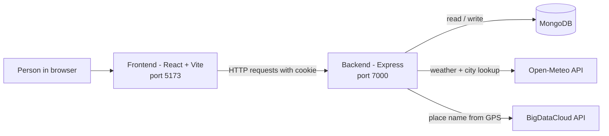

**Simple analogy — a restaurant**
- Frontend = the dining room and menu (what the customer sees)
- Backend = the kitchen (does the real work)
- Database = the pantry/fridge (stores everything)
- Open-Meteo = the supplier you order fresh ingredients from

### Two kinds of users

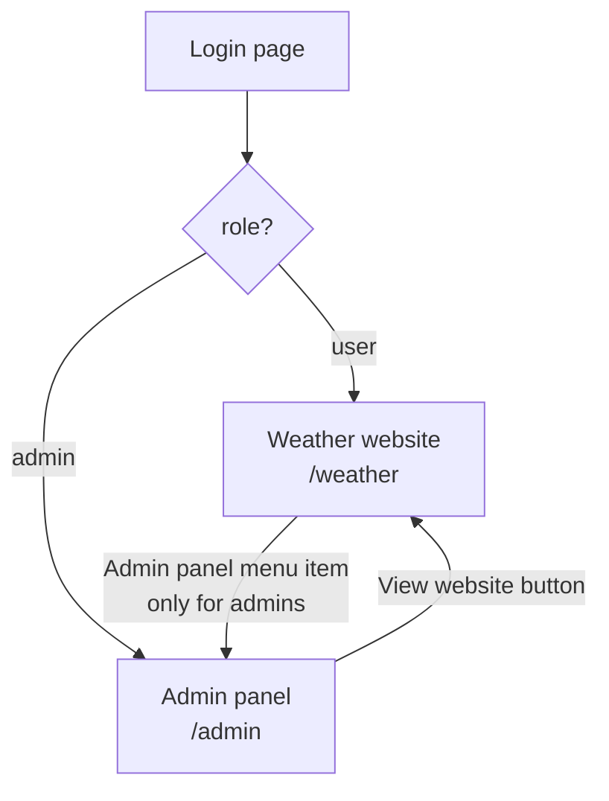

---

## 2. Tech used (and why)

| Tool | What it is | Why it is here |
|---|---|---|
| **Node.js** | Lets JavaScript run outside the browser | Runs the backend |
| **Express 5** | A small web-server library for Node | Defines URLs like `/api/weather` |
| **MongoDB + Mongoose** | A database + a helper that gives it structure ("schemas") | Stores users, favourites, logs |
| **express-session + connect-mongo** | Keeps you logged in using a cookie; stores sessions in MongoDB | Login that survives page refresh |
| **argon2** | Password hashing | Passwords are never stored as plain text |
| **cors / dotenv** | Allow the frontend to call the backend / read `.env` secrets | Config |
| **React 19** | Library for building UIs from components | The whole frontend |
| **Vite** | Fast dev server + builder | `npm run dev` |
| **react-router-dom** | Page navigation without reloading | `/weather`, `/admin/users` … |
| **lucide-react** *(new)* | A set of professional, consistent SVG icons | Replaces emoji icons |

---

## 3. How to run it

You need: **Node.js** and a **MongoDB** (local or Atlas). Open two terminals.

```bash
# Terminal 1 — backend
cd Backend
npm install
npm start            # runs nodemon app.js

# Terminal 2 — frontend
cd Frontend
npm install          # installs lucide-react too
npm run dev          # opens http://localhost:5173
```

**Backend `.env` file** (already in your project) needs:
```
PORT=7000
DBURL=mongodb://...your connection string...
SESSION_SECRET=some-long-random-text
```
Optional: `CLIENT_URL` (backend; the allowed frontend address, default `http://localhost:5173`) and `VITE_API_URL` (frontend; default `http://localhost:7000`).

**Make yourself an admin:** register normally, then in MongoDB (Compass or Atlas) open the `users` collection and change your user's `role` from `"user"` to `"admin"`. Log out and in again.

---

## 4. Folder map

```
backend_practice/
├── PROJECT_GUIDE.md        <- this file
├── CHANGES.md              <- short change summary
├── Backend/
│   ├── app.js              <- starts everything
│   ├── .env                <- secrets (never share/commit)
│   ├── models/             <- shapes of database data
│   ├── routes/             <- URL definitions (what URL does what)
│   ├── controllers/        <- login/register logic
│   ├── middleware/         <- "security guards" that run before routes
│   └── utils/              <- helper functions (tracking, device info)
└── Frontend/
    ├── index.html          <- the one HTML page React fills
    ├── vite.config.js
    └── src/
        ├── main.jsx        <- React starts here
        ├── App.jsx         <- list of all pages (routes)
        ├── lib/            <- small helpers (API caller, formatting)
        ├── context/        <- shared app state (who is logged in, weather data)
        ├── hooks/          <- reusable logic (active-time tracker, data loader)
        ├── components/     <- reusable UI pieces
        ├── pages/          <- one file per screen
        └── styles/         <- CSS (design)
```

---

## 5. Backend explained

### 5.1 How a request travels through the backend

Every time the frontend calls the backend, the request passes through a chain, like airport security:

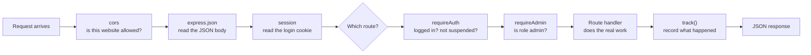

- **Middleware** = a function that runs *before* your route and can stop the request (for example "401 please log in").
- `requireAuth` also **loads the user from the database** each time, which is how a suspended user gets blocked *instantly*.

### 5.2 `app.js` (the entry point)
Loads `.env`, sets up CORS (allows `http://localhost:5173` with cookies), JSON parsing (limit 3 MB for profile photos), sessions (cookie lasts 1 day, stored in MongoDB), mounts all route files under `/api/...`, adds a JSON "not found" and error handler, connects to MongoDB, then starts listening.

### 5.3 The route files

| URL prefix | File | Purpose |
|---|---|---|
| `/api/auth` | `authRoutes.js` → `authController.js` | register, login, me, logout |
| `/api/weather` | `weatherRoutes.js` | weather lookup, history, favourites |
| `/api/users` | `userRoutes.js` | profile, photo, password, own activity, serve photos |
| `/api/track` | `trackRoutes.js` | heartbeat (active time) |
| `/api/admin` | `adminRoutes.js` | everything the admin panel shows |
| `/api/public` | `publicRoutes.js` | safe site settings (no login needed) |
| `/api/tasks` | `taskRoutes.js` | your original practice task feature (unchanged) |

---

## 6. Database tables (collections)

MongoDB calls tables *collections* and rows *documents*. Here is how they connect:

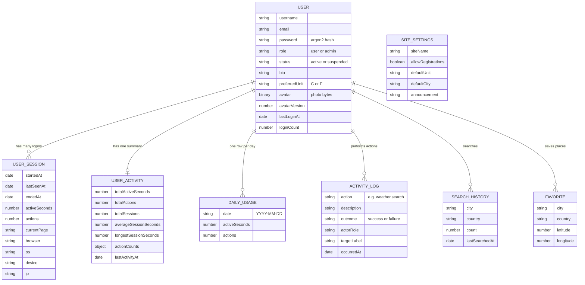

| Collection | One document means | Used for |
|---|---|---|
| `users` | one account | login, profile, role, photo |
| `usersessions` | one login session | **Sessions page**, per-login active time |
| `useractivities` | one user's lifetime totals | **Active time / Actions** columns |
| `dailyusages` | one user on one day | **usage charts** |
| `activitylogs` | one thing a person did | **Activity log page**, audit trail |
| `searchhistories` | one place a user searched | recent searches, admin Searches |
| `favorites` | one saved place | Favourites page, admin Favourites |
| `sitesettings` | the single settings record | Settings page, announcement banner |
| `tasks` | your old practice tasks | `/tasks` page (unchanged) |

> **Photo storage:** the profile photo is stored inside the user document (`avatar.data`), but hidden from normal queries (`select: false`) so the user list stays fast. It is only read by `GET /api/users/:id/avatar`. `avatarVersion` changes on each upload so the browser refreshes its cached copy.

---

## 7. Key flows with diagrams

### 7.1 Login (and how you stay logged in)

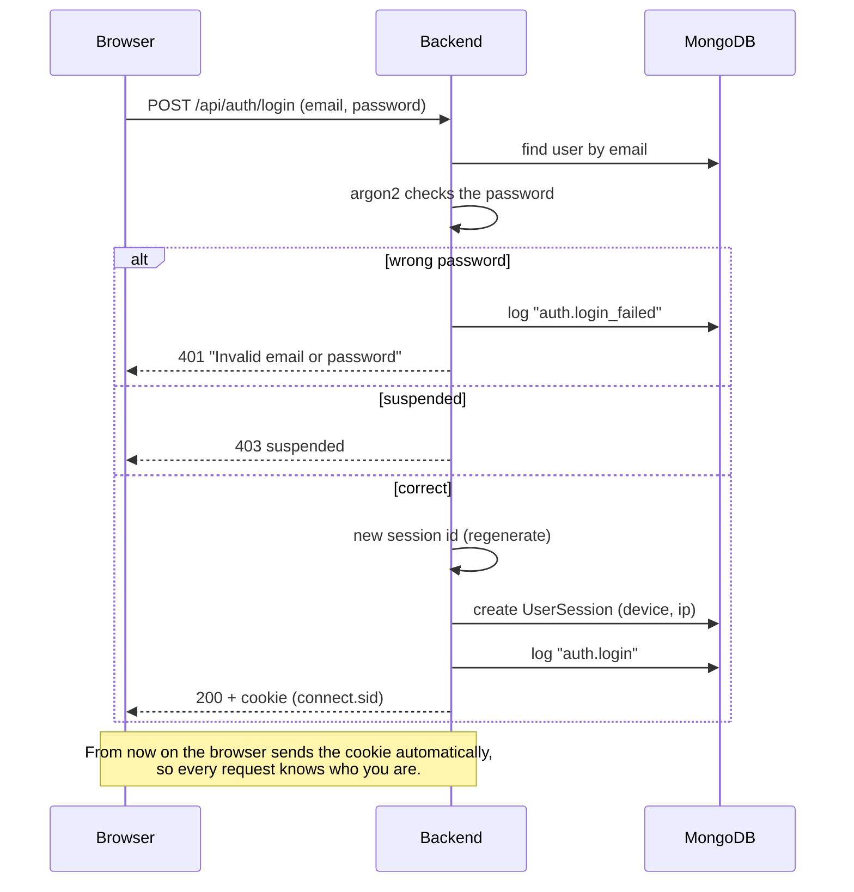

### 7.2 Searching for a city

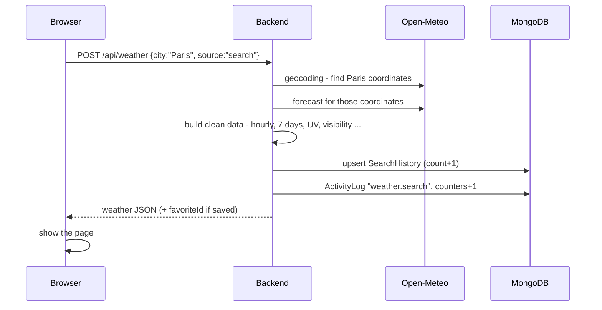

The `source` field tells the backend *why* the weather is requested, so it tracks correctly:

| source | when | saved to history? | tracked? |
|---|---|---|---|
| `search` | typed in the search box | yes | yes (search) |
| `history` / `favorite` / `location` | clicked a saved item / used GPS | no | yes (view) |
| `default` | page opened automatically | no | no |

### 7.3 Active time (heartbeat) — the fix for "Not tracked"

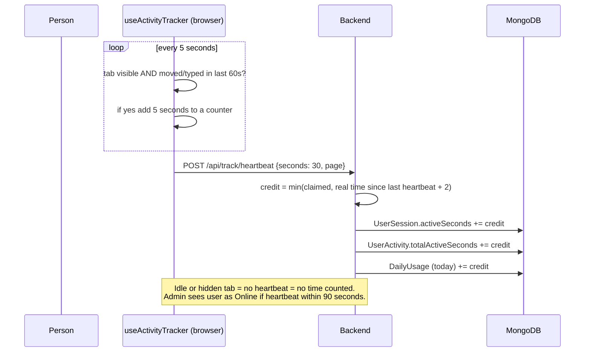

### 7.4 One action recorded in three places (`track()`)

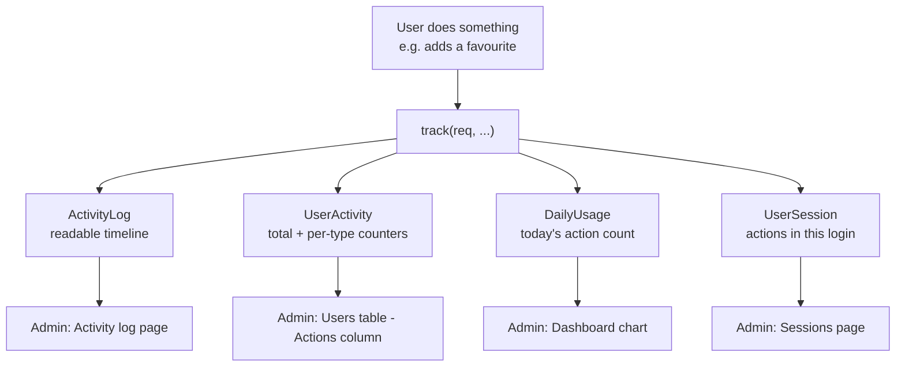

### 7.5 Profile photo upload

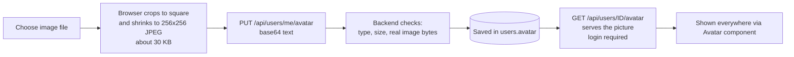

### 7.6 Admin suspending a user

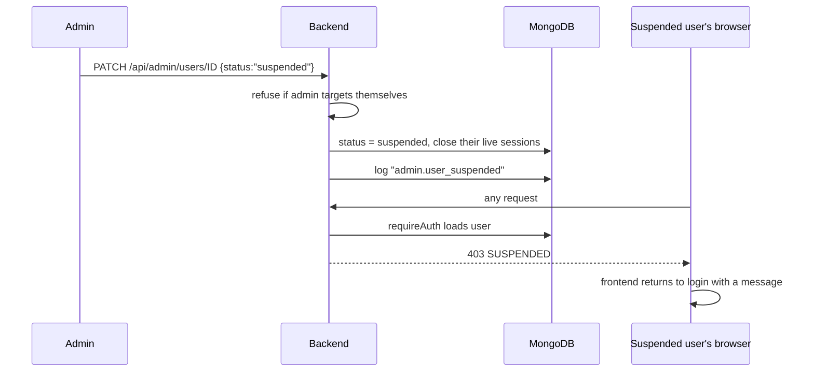

---

## 8. API cheat-sheet

`Auth: —` public, `U` any logged-in user, `A` admin only.

**Auth**
| Method | URL | Auth | What it does |
|---|---|---|---|
| POST | `/api/auth/register` | — | create account (checks duplicates, length, registrations open) |
| POST | `/api/auth/login` | — | log in; 429 after too many failures |
| GET | `/api/auth/me` | U | current user |
| POST | `/api/auth/logout` | — | end session |

**Weather**
| Method | URL | Auth | What it does |
|---|---|---|---|
| POST | `/api/weather` | U | weather by `city` or `latitude`+`longitude`, with `source` |
| GET | `/api/weather/history` | U | my recent searches |
| DELETE | `/api/weather/history/:id` | U | delete one |
| DELETE | `/api/weather/history` | U | clear all |
| GET | `/api/weather/favorites` | U | my saved places + live temperature |
| POST | `/api/weather/favorites` | U | save a place (max 24) |
| DELETE | `/api/weather/favorites/:id` | U | remove |

**Users / profile**
| Method | URL | Auth | What it does |
|---|---|---|---|
| GET | `/api/users/me` | U | profile + my stats |
| PATCH | `/api/users/me` | U | name, bio, unit |
| PUT | `/api/users/me/password` | U | change password |
| PUT/DELETE | `/api/users/me/avatar` | U | set / remove photo |
| GET | `/api/users/me/activity` | U | my recent actions |
| GET | `/api/users/:id/avatar` | U | the photo image |
| POST | `/api/track/heartbeat` | U | report active seconds |
| GET | `/api/public/settings` | — | site name, announcement, registrations open |

**Admin** (all need `A`)
| Method | URL | What it does |
|---|---|---|
| GET | `/api/admin/stats` | dashboard numbers, charts |
| GET | `/api/admin/users` | list with search/filters + active time/actions |
| GET | `/api/admin/users/:id` | full user detail |
| PATCH | `/api/admin/users/:id` | change role / suspend / reactivate |
| DELETE | `/api/admin/users/:id` | delete user + their data |
| GET | `/api/admin/activity` (+ `/export`) | activity log, filters, CSV |
| GET | `/api/admin/sessions` | sessions, live ones |
| GET/DELETE | `/api/admin/searches` | all searches, delete one |
| GET/DELETE | `/api/admin/favorites` | all saved places, delete one |
| GET | `/api/admin/security` | failed logins, suspended, admin changes |
| GET/PUT | `/api/admin/settings` | site settings |

---

## 9. Frontend explained

### 9.1 Route (page) map

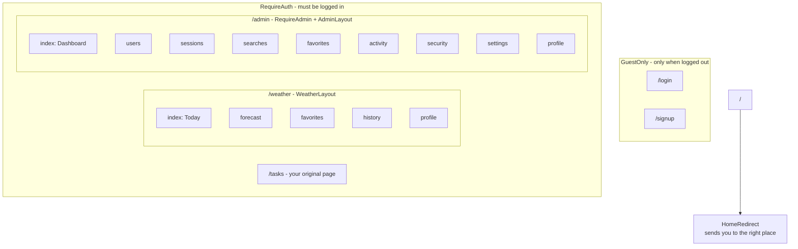

### 9.2 How the app is wrapped (providers)

"Providers" make shared data available to every component below them without passing it down by hand.

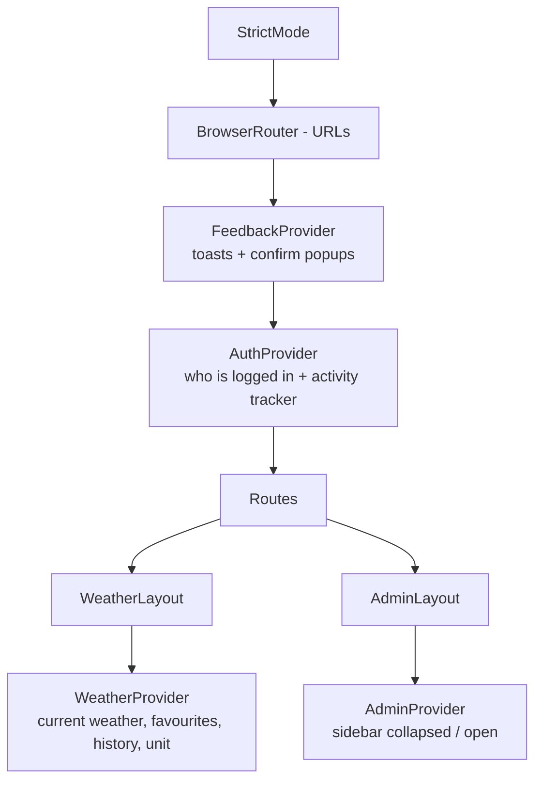

### 9.3 Weather website components

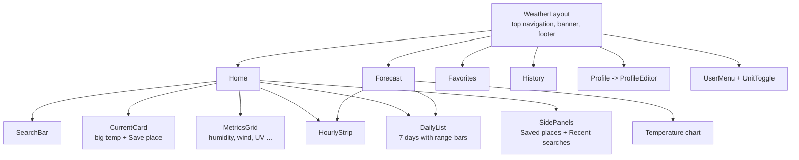

### 9.4 Admin panel components

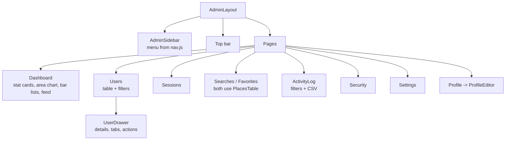

### 9.5 How data flows inside React

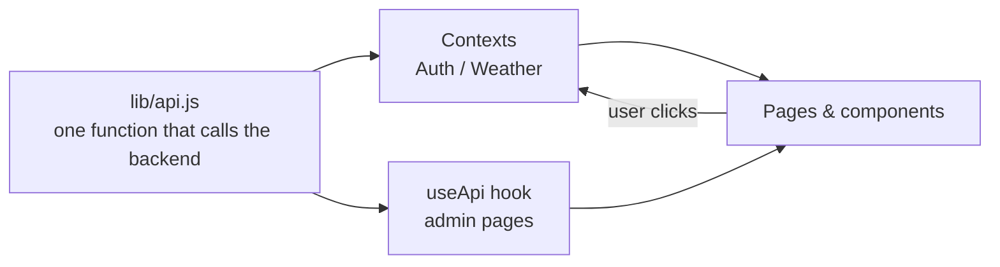

- **Weather side** keeps its data in `WeatherContext` (one shared brain).
- **Admin side** pages each fetch what they need with the `useApi(path)` hook, which also refreshes automatically (for example Sessions every 10 seconds).
- If any call returns "not logged in", `api.js` sends a global event and `AuthContext` logs you out and shows the login page.

---

## 10. Every file, one by one

### Backend

| File | What it does |
|---|---|
| `app.js` | Entry point: middleware, routes, DB connection, starts server. Also gives old search rows a `count` of 1 on start. |
| `.env` | Secrets: port, DB URL, session secret. Never upload this to GitHub. |
| `models/Users.js` | User schema (+ `toPublic()` that never leaks password/photo bytes). Status, bio, unit, avatar. |
| `models/UserSession.js` | One login: times, active seconds, device, current page. |
| `models/UserActivity.js` | Lifetime totals per user and per-action counters. (Its old `dailyUsage` array field is no longer used.) |
| `models/DailyUsage.js` | **New.** One row per user per day for charts. |
| `models/ActivityLog.js` | The readable timeline (your existing model). |
| `models/SearchHistory.js` | Searched places with count and last time. |
| `models/Favorite.js` | Saved places (unique per user+city+country). |
| `models/SiteSettings.js` | Single settings document. |
| `models/Task.js` | Your original practice model. |
| `controllers/authController.js` | Register / login / me / logout logic with validation, lockout, session start. |
| `controllers/taskController.js` | Your original practice code. |
| `middleware/requireAuth.js` | Must be logged in; loads user; blocks suspended. |
| `middleware/requireAdmin.js` | requireAuth + role must be admin. |
| `routes/authRoutes.js` | Wires auth URLs to the controller. |
| `routes/weatherRoutes.js` | Weather fetch + history + favourites; turns raw Open-Meteo data into clean data. |
| `routes/userRoutes.js` | Profile, password, photo upload/serve, my activity. |
| `routes/trackRoutes.js` | Heartbeat endpoint. |
| `routes/adminRoutes.js` | All admin APIs. |
| `routes/publicRoutes.js` | Public safe settings. |
| `routes/taskRoutes.js` | Your original practice routes. |
| `utils/track.js` | **The one function to record any action** (see section 11). |
| `utils/logActivity.js` | Writes one ActivityLog entry (existing). |
| `utils/recordActivity.js` | Updates counters + daily row. |
| `utils/sessionTracker.js` | Start/end session, heartbeat with anti-cheat cap. |
| `utils/clientInfo.js` | Reads browser / OS / device / IP from the request. |
| `package.json` | Backend dependencies and `npm start`. |

### Frontend — core

| File | What it does |
|---|---|
| `index.html` | The single HTML page; loads the Inter font; React mounts in `#root`. |
| `src/main.jsx` | Starts React, imports all CSS. |
| `src/App.jsx` | The full route list (section 9.1). |
| `vite.config.js` | Vite settings; dev proxy `/api` → port 7000. |
| `public/favicon.svg` | The sun-and-cloud browser-tab icon. |
| `package.json` | Frontend dependencies (adds `lucide-react`). |

### Frontend — `lib/` (helpers)

| File | What it does |
|---|---|
| `api.js` | `api(path, {...})` — one place for backend address, cookies, error messages, auto-logout on 401. |
| `format.js` | Time ago, durations ("2h 14m"), dates, °C↔°F, greeting. |
| `actions.js` | Maps backend action codes (like `favorite.added`) to a label, icon and colour. |
| `image.js` | Crops and shrinks a chosen photo in the browser. |
| `routes.js` | `homeFor(user)` — admin → `/admin`, user → `/weather`. |

### Frontend — `context/` and `hooks/`

| File | What it does |
|---|---|
| `context/AuthContext.jsx` | Current user, login/register/logout, session-expired handling, starts the tracker. |
| `context/WeatherContext.jsx` | Current weather, search, favourites, history, unit, GPS, all the actions. |
| `context/AdminContext.jsx` | Sidebar collapsed/open state (remembered). |
| `hooks/useActivityTracker.js` | Measures real active time and sends heartbeats. |
| `hooks/useApi.js` | Loads data for admin pages with auto-refresh and loading/error state. |

### Frontend — `components/`

| File | What it does |
|---|---|
| `RouteGuards.jsx` | RequireAuth, RequireAdmin, GuestOnly, HomeRedirect. |
| `ProfileEditor.jsx` | Photo, details, password, usage stats, recent activity (shared by user and admin). |
| `ui/Feedback.jsx` | Toast messages, confirm dialogs, spinners. |
| `ui/Avatar.jsx` | Photo or neat initials. |
| `ui/WeatherIcon.jsx` | Picks the right icon (sun, moon, cloud, rain, storm, snow, fog …). |
| `ui/Logo.jsx` | Brand mark drawn as SVG. |
| `ui/Charts.jsx` | Area chart, column chart, ranked bar list (hand-drawn SVG, no chart library). |
| `ui/Pagination.jsx`, `ui/EmptyState.jsx` | Small shared pieces. |
| `weather/CurrentCard.jsx` | Big current-weather card with "Save place". |
| `weather/MetricsGrid.jsx` | 8 condition tiles. |
| `weather/describe.js` | Turns numbers into words ("Humid", "High UV"). |
| `weather/HourlyStrip.jsx`, `DailyList.jsx` | Hourly cards and 7-day list. |
| `weather/SearchBar.jsx`, `SidePanels.jsx`, `UnitToggle.jsx`, `UserMenu.jsx` | Search, saved/recent panels, °C/°F switch, account dropdown. |
| `admin/AdminSidebar.jsx`, `admin/nav.js` | The sidebar and its menu list. |
| `admin/bits.jsx` | Page header, stat card, badges, user cell, row menu, skeletons. |
| `admin/UserDrawer.jsx` | Side panel with a user's full details and admin actions. |
| `ContactUs, TaskForm, TaskList, Testing, Task.css` | **Your originals, unchanged** (used on `/tasks`). |

### Frontend — `pages/`

| File | What it does |
|---|---|
| `auth/AuthShell.jsx`, `Login.jsx`, `Signup.jsx` | Login / sign-up screens. |
| `weather/WeatherLayout.jsx` | Top navigation + page frame. |
| `weather/Home.jsx`, `Forecast.jsx`, `Favorites.jsx`, `History.jsx`, `Profile.jsx` | The five weather screens. |
| `admin/AdminLayout.jsx` | Sidebar + top bar frame. |
| `admin/Dashboard.jsx`, `Users.jsx`, `Sessions.jsx`, `Searches.jsx`, `Favorites.jsx`, `PlacesTable.jsx`, `ActivityLog.jsx`, `Security.jsx`, `Settings.jsx`, `Profile.jsx` | The admin screens. |

### Frontend — `styles/`

| File | What it does |
|---|---|
| `base.css` | Design tokens (colours, radius, shadows) + buttons, forms, cards, tables, toasts, modals, charts. |
| `auth.css` | Login/sign-up look. |
| `weather.css` | Weather website look (hero gradient changes with the weather). |
| `admin.css` | Admin sidebar, top bar, stat cards, drawer. |

> **Design idea:** all colours live as variables at the top of `base.css` (for example `--accent`). Change `--accent: #2457e6;` there and the whole app's blue changes.

---

## 11. How tracking works (the "Not tracked" fix)

**Why it was "Not tracked" before:** the function that counts actions existed but **nothing ever called it**, and active time had no code at all.

**Now:** every important place calls `track()` once:

```js
await track(req, {
  action: "favorite.added",
  description: "Added Paris, France to favourites",
  targetLabel: "Paris, France",
});
```

| What the person does | Action code recorded |
|---|---|
| Creates account / signs in / signs out | `auth.register` / `auth.login` / `auth.logout` |
| Wrong password | `auth.login_failed` (counts toward the lockout) |
| Searches a city | `weather.search` (or `weather.search_failed`) |
| Opens a saved/recent place or uses GPS | `weather.view` |
| Deletes one search / clears all | `weather.history_deleted` / `weather.history_cleared` |
| Adds / removes a favourite | `favorite.added` / `favorite.removed` |
| Edits profile / changes photo / removes photo | `profile.updated` / `profile.avatar_changed` / `profile.avatar_removed` |
| Changes °C/°F | `ui.unit_changed` |
| Changes password | `auth.password_changed` (or `..._change_failed`) |
| Admin changes role / suspends / deletes / edits settings | `admin.*` |

---

## 12. Security notes

- Passwords: hashed with **argon2** — even you can't read them.
- Login errors are generic ("Invalid email or password") so nobody can discover which emails exist.
- After 8 failed logins within 10 minutes the account is temporarily locked (429).
- New session id on every login (stops *session fixation*).
- Suspended users are blocked on **every** request, instantly.
- Admin routes check the role **on the server** — hiding a menu in the browser alone would not be safe.
- Admins can't demote, suspend or delete themselves.
- Photo uploads are checked: allowed types, size limit, and the file's real first bytes must match an image.
- Profile photos need login to view.
- Search/regex inputs are escaped so users can't break queries.

**Not done yet (ideas for later):** rate limiting for all routes, HTTPS-only cookies for production (`secure: true`, `sameSite`), email verification, "forgot password".

---

## 13. Bugs found and fixed

| Problem | Fix |
|---|---|
| History route was written *inside* the POST handler, so it only worked after one search | Rewritten as separate routes |
| Hourly forecast showed midnight–6 AM, not the next hours | Starts at the current hour |
| Visibility / UV / pressure were never sent, so the UI showed blank | Now included |
| "Not logged in" error was treated as a logged-in user in React | New `AuthContext` + route guards |
| Login revealed whether an email exists | Generic error |
| Active time and actions never recorded | `track()` + heartbeat |
| (Found by my tests) positional-array daily usage was fragile | New `DailyUsage` collection |
| (Found by my tests) dashboard "Searches" dropped when history cleared | Uses lifetime counter |
| Frontend called port 7000 but the dev proxy pointed to 6000 | Proxy fixed to 7000 |

---

## 14. Glossary (beginner words)

| Word | Meaning |
|---|---|
| **API** | A menu of URLs the frontend can call to get/save data |
| **Route** | One URL + method, like `POST /api/weather` |
| **Middleware** | Code that runs before the route (checks login etc.) |
| **Schema / Model** | The shape of a database record |
| **Session / Cookie** | How the server remembers you are logged in |
| **Hash** | One-way scrambling of a password |
| **Context** | React's way of sharing data with many components |
| **Hook** | A reusable React function starting with `use` |
| **Component** | A reusable piece of UI |
| **Provider** | A component that supplies context data |
| **Heartbeat** | A tiny "I'm still here" message sent regularly |
| **Aggregation** | A database query that adds up/groups many records |
| **CORS** | Browser rule about which website may call which server |
| **Proxy** | Dev-server trick forwarding `/api` calls to the backend |
| **Base64** | Turning an image into text so it can travel as JSON |

---

## 15. Troubleshooting

| Symptom | Likely cause / fix |
|---|---|
| Login works but you are immediately logged out | Backend and frontend not both running, or `CLIENT_URL`/port mismatch. Use `localhost` for both. |
| "Can't reach the server" | Backend not running or wrong port; check `VITE_API_URL`. |
| Everything shows Unknown/empty on admin | You are not admin: set `role: "admin"` in MongoDB, log in again. |
| Weather says service not responding | The server has no internet or Open-Meteo is down. |
| Photo upload fails | Must be PNG/JPG/WebP. Backend must be the new version (JSON limit 3 MB). |
| Active time stays 0 | Keep the tab open and move the mouse for 30+ seconds; check Network tab for `/api/track/heartbeat`. |
| `Cannot find module 'lucide-react'` | Run `npm install` inside `Frontend`. |

---

## 16. How to read and change the code

**Best reading order (backend):** `app.js` → `models/Users.js` → `routes/authRoutes.js` + `controllers/authController.js` → `middleware/requireAuth.js` → `routes/weatherRoutes.js` → `utils/track.js`.

**Best reading order (frontend):** `main.jsx` → `App.jsx` → `context/AuthContext.jsx` → `pages/weather/Home.jsx` → `context/WeatherContext.jsx` → one small component such as `CurrentCard.jsx`.

**Easy first changes to try**
1. Change the site colour: `--accent` in `styles/base.css`.
2. Change the number of favourites allowed: `MAX_FAVORITES` in `routes/weatherRoutes.js`.
3. Add a new tracked action: pick a code like `weather.share`, call `track(...)` in the route, then add one line for it in `Frontend/src/lib/actions.js`.
4. Change how long "online" lasts: `LIVE_WINDOW_MS` in `utils/sessionTracker.js`.

*End of guide.*


---

## 17. Version 2: what was added

### 17.1 Your list, and where each item lives

| Feature | Backend | Frontend |
|---|---|---|
| Weather alerts (heat, storm, heavy rain, wind, UV, air, fog) | `utils/insights.js` → `buildAlerts` | `AlertsBanner.jsx` |
| Air quality (AQI) + pollen | `providers/openmeteo.js` → `getAirQuality` | `AirQualityCard.jsx` |
| Radar / rain map | — (browser talks to RainViewer) | `RadarMap.jsx` (Leaflet) |
| "Rain starts in 30 min" | `buildNowcast` (15-minute data) | `NowcastCard.jsx` |
| Sun arc, golden hour, moon phase | `utils/astro.js`, `weatherService.js` | `SunMoonCard.jsx` |
| Why it feels hotter | `explainFeelsLike` | `InsightsCard.jsx` |
| Smart summary line | `buildSummary` | `InsightsCard.jsx` |
| "Warmer than usual" | `utils/climate.js` (10 years of history) | `InsightsCard.jsx` |
| Weekly + monthly charts | `GET /weather/trends` | `TempRainChart.jsx`, Forecast page |
| Units (wind, pressure, °C/°F, 12/24h) | stored on the user | `lib/units.js`, `PrefsContext` |
| Search autocomplete | `utils/geo.js`, `GET /geo/search` | `PlaceSearch.jsx` |
| Compare cities | `POST /weather/compare` | `pages/weather/Compare.jsx` |
| Reorder / rename / home city | favourites routes | `pages/weather/Favorites.jsx` |
| Recently viewed (no typing) | `recordPlace` in `weatherRoutes.js` | `SidePanels.jsx`, `History.jsx` |
| Trip planner | `POST /weather/trip` | `pages/weather/Trip.jsx` |
| Daily digest + rain-tomorrow alerts | `utils/scheduler.js` | `NotificationSettings.jsx`, `NotificationsBell.jsx` |
| Custom alert rules | `AlertRule` model, `notificationRoutes.js` | `NotificationSettings.jsx` |
| Dark mode (website **and** admin) | — | `PrefsContext`, CSS variables in `base.css` |
| Hindi + English | — | `src/i18n/` |
| "Good day for run / laundry / travel" | `buildRecommendations` | `RecommendationsCard.jsx` |
| Forgot password, email verification | `authController.js`, `utils/tokens.js`, `utils/mailer.js` | `pages/auth/*` |
| Google login | `googleLogin` in `authController.js` | `GoogleButton.jsx` |
| Delete account / download data | `routes/accountRoutes.js` | `SecurityPanel.jsx` |
| Active devices | `accountRoutes.js`, `utils/sessions.js` | `SecurityPanel.jsx` |
| Two-factor authentication | `accountRoutes.js`, `utils/totp.js` | `SecurityPanel.jsx`, `Login.jsx` |

### 17.2 Why the weather could be "wrong" — and what changed

There were two separate problems:

1. **Wrong place** (e.g. "Gujarat" found in Nepal). The old code searched by name and took the *first* result. This was the real cause of the weird errors.
2. **A single weather source.** If it failed or sent nonsense, the page showed nonsense.

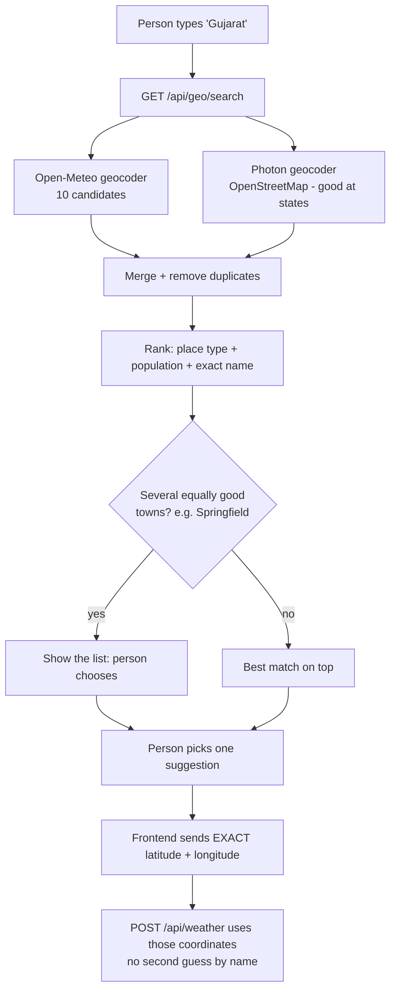

How ranking works (`utils/geo.js`): a capital scores +40, a state +35, a regional seat +30; an exact name match +60; population adds points (a city of 10 million beats a hamlet); an unknown tiny place loses 15. So the Indian state *Gujarat* (from Photon) beats the Nepal village *Gujarat*. The Nepal match is still in the list, just lower.

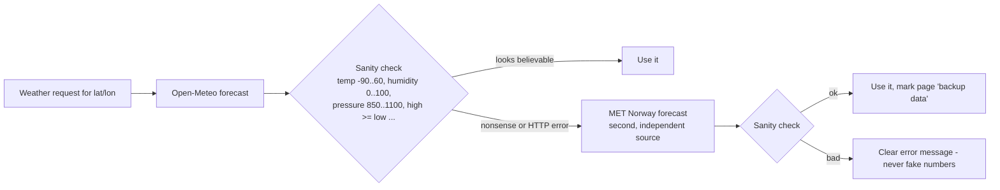

MET Norway does not provide UV, visibility, air quality or rain probability, so on backup data the page shows "—" or hides those cards and displays a notice. Results are cached 5 minutes (`utils/cache.js`) so the same place is not requested again and again.

### 17.3 How alerts, summary and advice are decided (`utils/insights.js`)

| Alert | Watch | Warning | Severe |
|---|---|---|---|
| Heat (daily high) | ≥ 38° | ≥ 40° | ≥ 45° |
| Cold (daily low) | ≤ 0° | ≤ -10° (warning) | — |
| Heavy rain (24 h) | ≥ 30 mm | ≥ 64.5 mm | ≥ 115.6 mm |
| Wind (gusts) | ≥ 50 km/h | ≥ 75 km/h | — |
| Air (US AQI) | ≥ 150 | ≥ 200 | ≥ 300 |
| UV (today) | ≥ 8 | ≥ 11 | — |
| Thunderstorm | — | any forecast storm | — |
| Fog | visibility < 1 km | — | — |

These are **generated from forecast numbers, not official government warnings**, and the page says so. The rain thresholds follow the India Met Department's "heavy / very heavy" bands.

Texts are sent as `{ key, params }` (for example `{ key: "rainAt", params: { time: "2026-10-12T16:00" } }`) and the browser turns them into English or Hindi. That is why alerts, summary and notifications can all change language.

### 17.4 New database collections

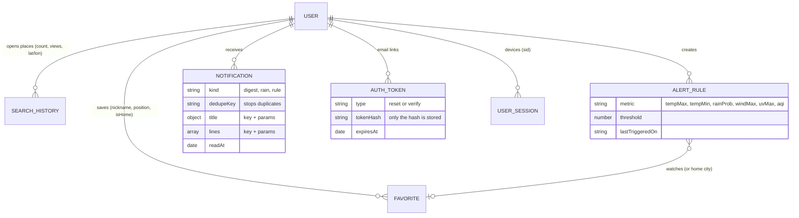

New fields on `User`: `emailVerified`, `authProvider` (`local`/`google`), `passwordSet`, two-factor fields (secret stored **encrypted**, backup codes stored **hashed**), units (`windUnit`, `pressureUnit`, `clock`), `theme`, `language`, and notification settings.

### 17.5 Accounts

**Two-factor sign-in**

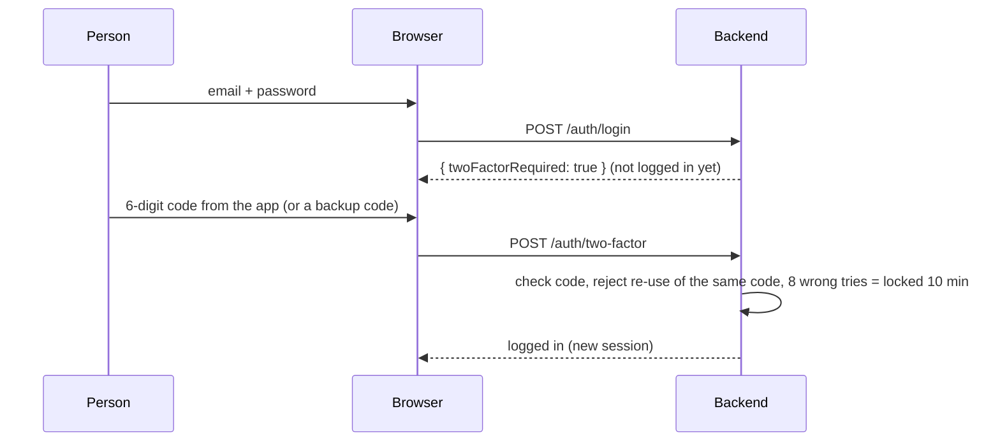

Turning it on (Settings → Security): the backend creates a secret, the page shows a QR code, the person scans it, types one code to prove it works, and receives 8 one-time backup codes (shown once).

**Forgot password** → `POST /auth/forgot-password` always answers the same way (so nobody can discover which emails exist) → an email with a one-hour link → `POST /auth/reset-password` → **all other devices are signed out**. The link works once.

**Email verification** → link in the welcome email → `/verify-email?token=…` → banner disappears. Accounts created before version 2 are treated as verified.

**Google sign-in** → Google's button gives the browser a signed token → `POST /auth/google` → the backend verifies it with Google's keys → account is found or created. It only appears when `GOOGLE_CLIENT_ID` is set.

**Devices** → every login is a `UserSession` that remembers the session id, so "Sign out" on another device really destroys that session. **Download my data** → JSON file. **Delete account** → needs your password (or typing `DELETE` for Google accounts), removes everything, and refuses if you are the only admin.

### 17.6 Notifications

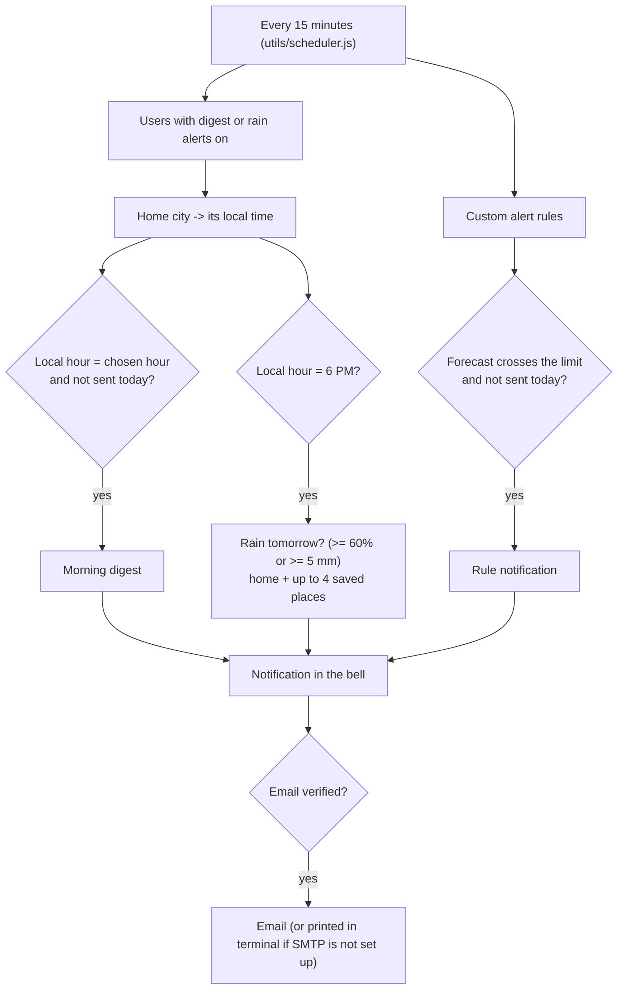

Each message has a `dedupeKey`, so the same alert is never created twice even if the scheduler runs again.

### 17.7 Frontend: preferences, dark mode, languages

- `PrefsContext` is the one place that knows the person's theme, language, units and clock, and it gives every screen formatting helpers (`fmt.temp(31)` → `88°` in Fahrenheit; `fmt.clock(...)` → `17:57` in 24-hour mode; `t("key")` → text in the chosen language).
- **Dark mode:** every colour in `styles/base.css` is a CSS variable. `:root[data-theme="dark"]` overrides them. A tiny script in `index.html` sets the theme *before* the page paints, so there is no white flash. The map uses a CSS filter to darken.
- **Admin console** is forced to English (`PrefsOverride`) but supports dark mode.
- **Add a language:** copy `src/i18n/en.js` to `fr.js`, translate the values, register it in `src/i18n/index.js` and in the `language` list in `Backend/models/Users.js`. Run `npm run check:i18n` — it tells you every missing key.
- Emails are English only; notifications in the app are translated.

```mermaid
flowchart TD
    AP["AuthProvider (who is logged in)"] --> PP["PrefsProvider<br/>theme, language, units, clock, t(), fmt"]
    PP --> WL["WeatherLayout -> WeatherProvider<br/>current weather, favourites, history"]
    PP --> AL["AdminLayout -> PrefsOverride(en)"]
    WL --> Pages["Today / Forecast / Compare / Trip / Favourites / Recent / Settings / Profile"]
```

### 17.8 New API endpoints

| Method | URL | What it does |
|---|---|---|
| GET | `/api/geo/search?q=` | ranked place suggestions with exact coordinates |
| POST | `/api/weather` | full weather page data for one place (now with air, alerts, summary, astro, nowcast) |
| GET | `/api/weather/trends` | last 30 days |
| POST | `/api/weather/compare` | 2–4 places |
| POST | `/api/weather/trip` | up to 14 days, forecast or "typical" |
| PATCH/PUT | `/api/weather/favorites/:id`, `/favorites/order` | rename, home city, reorder |
| POST | `/api/auth/two-factor`, `/google`, `/forgot-password`, `/reset-password`, `/verify-email`, `/resend-verification` | sign-in extras |
| GET/POST/DELETE | `/api/account/devices`, `/devices/revoke-others`, `/export`, `/` (delete) | devices, data, account |
| POST | `/api/account/2fa/setup`, `/2fa/enable`, `/2fa/disable` | two-factor |
| GET/POST | `/api/notifications`, `/notifications/read` | bell inbox |
| GET/POST/PATCH/DELETE | `/api/notifications/rules` | custom alert rules |

### 17.9 Settings (`Backend/.env`)

See `Backend/.env.example`. Nothing new is *required*: without SMTP, emails are printed in the backend terminal (the reset/verify links are there); without `GOOGLE_CLIENT_ID` the Google button is hidden.

**To turn on Google login:** Google Cloud Console → APIs & Services → Credentials → Create OAuth client ID (type *Web application*) → add `http://localhost:5173` under *Authorised JavaScript origins* → paste the Client ID into `GOOGLE_CLIENT_ID`.

### 17.10 Updated file additions

Backend: `providers/` (openmeteo, metno, index), `services/weatherService.js`, `utils/` (geo, insights, climate, conditions, astro, cache, http, time, totp, crypto, mailer, tokens, sessions, accountCleanup, messages, scheduler), `models/` (Notification, AlertRule, AuthToken, DailyUsage), `routes/` (accountRoutes, notificationRoutes, geoRoutes), `scripts/checkApis.js`, `tests/`.
Frontend: `src/i18n/`, `context/PrefsContext.jsx`, `lib/units.js`, `lib/insights.js`, `components/settings/*`, `components/weather/*` (PlaceSearch, AlertsBanner, InsightsCard, RecommendationsCard, NowcastCard, AirQualityCard, SunMoonCard, RadarMap), `components/ui/TempRainChart.jsx`, `NotificationsBell`, `VerifyBanner`, `ThemeToggle`, `GoogleButton`, pages `Compare`, `Trip`, `Settings`, `ForgotPassword`, `ResetPassword`, `VerifyEmail`.
Removed because they became unnecessary: `SearchBar.jsx`, `UnitToggle.jsx` (replaced by `PlaceSearch` and the Settings page).

### 17.11 Tests and checks you can run

| Command (folder) | What it checks |
|---|---|
| `npm test` (Backend) | 27 unit tests: place ranking incl. Gujarat/Delhi/Paris/Springfield, weather fallback, sanity checks, alerts, summary, advice, sun/moon maths, 2FA codes (official test vectors), encryption, caching |
| `npm run check:apis` (Backend) | **calls the real services** and checks places land in the right country and that Open-Meteo and MET Norway agree within a few degrees. **Please run this once on your computer.** |
| `npm run check:i18n` (Frontend) | every text key exists in English and Hindi, none unused |
| `npm run lint` is not set up; use `npx eslint src` | unused variables, undefined names |

I also ran (but did not include in the zip) a 329-check end-to-end API test and a 96-check browser simulation. They cover sign-up, login, 2FA incl. re-used codes, Google, reset, verification, devices, export/delete, notifications, rules, compare, trip, favourites ordering, and every screen in English, Hindi, light and dark.

### 17.12 Honest limits

- **Alerts are not official warnings** (they are computed from forecast numbers).
- "Minute-by-minute" rain is really **15-minute** steps (what the free data provides).
- **Pollen** exists only for Europe; elsewhere the page says so.
- **Push notifications** are not built; you get in-app notifications and email.
- **Emails** are English only. The admin console is English only.
- Radar uses RainViewer's free tier (limited zoom, past images). If their rules change, the Radar tab shows a friendly message.
- Google login needs your own Google client ID.
- On MET Norway backup data, UV, visibility, air quality and exact rain chance are missing.
- I could not call the real outside services from my environment; run `npm run check:apis`.

*End of guide.*


---

## Version 3 additions (16 Oct 2026)

**New backend routes**
* `GET /api/health`
* `GET/POST /api/push/*` (status, subscribe, unsubscribe, test)
* `GET/POST /api/support`, `POST /api/support/:id/reply`
* Admin: `GET /api/admin/analytics?days=`, `/retention`, `/system`, `/audit`, `/support`, `POST /support/:id/reply`, `PATCH /support/:id`, `POST /users/bulk`, `GET /reports/weekly`, `POST /reports/send`

**New environment variables** (all optional, see `Backend/.env.example`): `NODE_ENV`, `TRUST_PROXY`, `COOKIE_SAMESITE`, `API_RATE_LIMIT`, `AUTH_RATE_LIMIT`, `DISABLE_RATE_LIMIT`, `RUN_SCHEDULER_IN_APP`, `VAPID_PUBLIC_KEY`, `VAPID_PRIVATE_KEY`, `TOMORROW_API_KEY`, `GEOAPIFY_KEY`.

**New npm scripts (Backend)**: `npm run worker`, `npm run purge-sessions`.

**Frontend additions**: `components/ui/Viz.jsx` (chart kit), `WeatherScene.jsx`, `Reveal.jsx`, `Counter.jsx`, `hooks/useMotion.js`, `pages/auth/Mascot.jsx`, `styles/modern.css`, `styles/pages.css`, admin pages `Analytics`, `Support`, `System`, `Audit`.
